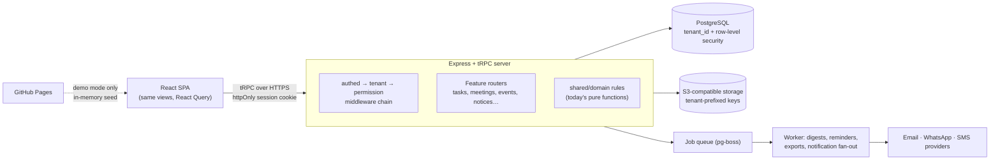

# Jambavan platform architecture

Status: **draft for review**. This set of documents designs the backend that turns the current UI prototype into a multi-tenant product. Nothing here is implemented yet.

| Document                                                         | Covers                                                                                                              |
| ---------------------------------------------------------------- | ------------------------------------------------------------------------------------------------------------------- |
| This file                                                        | What the product is, how the prototype works today, the target architecture, decisions needed and the delivery plan |
| [Authentication, tenancy and authorization](auth-and-tenancy.md) | Login, sessions, invitations, tenant isolation, roles, permissions and record-level rules                           |
| [Data model](data-model.md)                                      | Every table, the constraints the database enforces and how prototype fields map to columns                          |

## 1. What Jambavan is for

Jambavan is an execution and accountability workspace for coaching institutes. Its core loop:

1. A department meets. The **MOM Directory** records attendance and written minutes, then locks them.
2. Decisions become **owned tasks**. Every task has one Task Owner, optional Contributors, a due date, a family and a visibility.
3. People report work as it happens. They post progress journal entries, tick subtasks, attach completion evidence, check in on blockers, link dependencies and hand tasks over.
4. Leadership sees the result. The Department view, the Dashboard and the Audit Log show who is responsible for what, what is late and why.

Other modules feed the same loop:

| Area               | Modules                                                                                                                       |
| ------------------ | ----------------------------------------------------------------------------------------------------------------------------- |
| Execution          | Task feed, MOM Directory, Event Planner (multi-department plans and reusable templates), Projects                             |
| Communication      | Notices with targeting, expiry, private replies and Seen receipts; Feedback (polls, open questions, ratings); Yearly Calendar |
| People and control | Employee profiles, schedules and weekly offs, attendance and leave, Access Matrix, Audit Log, reports                         |
| Personal           | **My Day**, a private daily planner. Nobody else may read it, including leadership.                                           |

Task families follow the Ramayana: **Squirrel** for small work, **Angad** for a larger individual deliverable, **Sugriv** for coordinated team work and **HANUMAN** for long-running strategic missions. Jambavan is the counsellor who reminded Hanuman of his strength.

## 2. How the prototype works today

```
client/src/components/jambavan/
  state/useJambavanStore.ts   one React store: every list, draft and handler (~750 lines)
  state/MyDayProvider.tsx     My Day kept in a separate context so other views cannot read it
  state/seed.ts               example institute: 11 people, 4 departments, tasks, MOMs, events
  state/tasks.ts, handover.ts, dependencies.ts, eventPlans.ts, people.ts
                              pure business rules with unit tests (worth keeping; see §4)
  views/, modals/, task/      screens and dialogs
server/                       Manus webdev starter: Express + tRPC + Drizzle, only `auth.me` / `auth.logout`
drizzle/schema.ts             a single MySQL `users` table keyed by Manus `openId`
```

The prototype takes shortcuts that the backend must replace. Each one becomes a design requirement:

| Prototype shortcut                                                                                    | Where                                                         | Backend requirement                                                                  |
| ----------------------------------------------------------------------------------------------------- | ------------------------------------------------------------- | ------------------------------------------------------------------------------------ |
| People are identified by display name, and the signed-in user is the alias `"You"` or `"Arjun Mehta"` | `identity.ts`, every `assignee`, `addedBy` and `seenBy` field | Stable UUIDs for employees. Names are only for display.                              |
| Dates are display strings such as `"Today"`, `"Overdue · 2 days"` and `"05 Oct 2026, 3:15 PM"`        | `Task.due`, all `at` fields, `clock.ts`                       | Store `date` and `timestamptz` values. Compute labels in the tenant's time zone.     |
| One hardcoded user with a CEO/Director switch on the Dashboard                                        | `CURRENT_USER`, `leadershipRole`                              | Real sessions, with roles taken from the database                                    |
| Authorization exists only as hidden buttons, and many actions have no guard                           | `canManageEmployeeAccess`, `toggleAssistant`, `archiveTask`   | Enforce every rule on the server (see the auth doc §6)                               |
| IDs come from `Date.now()`                                                                            | everywhere                                                    | Generate IDs on the server                                                           |
| Attachments are `blob:` object URLs                                                                   | `addAttachments`                                              | Object storage with tenant-scoped keys and signed URLs                               |
| Notices expire through a browser `setInterval`                                                        | `expireNotices`                                               | Compute expiry from `expires_at` when a notice is read                               |
| Tasks can be hard-deleted                                                                             | `deleteTask`                                                  | Archive by default. Hard deletes are restricted and audited (see the data model doc) |
| Manus OAuth and a one-year, non-revocable JWT cookie                                                  | `server/_core/oauth.ts`, `sdk.ts`                             | Our own authentication with revocable server-side sessions                           |

GitHub Pages publishes only the static frontend. Pages cannot run the server or database, so it should keep serving the in-memory **demo mode** while the real product runs on a server host.

## 3. Target architecture



How a mutation runs, using "complete task" as the example:

1. The browser calls `tasks.complete({ taskId, expectedVersion })` with its session cookie.
2. `authedProcedure` loads the session and the user.
3. `tenantProcedure` checks that the user has an active employee record in the session's active tenant. It loads the role and permissions and opens a transaction with `app.tenant_id` set, so row-level security applies.
4. The router loads the task and calls the shared rule (`completeTask`, today's `completeTaskPure`). The rule refuses the call unless the actor is the Task Owner.
5. In the same transaction the server updates the task, closes any open blocker, writes an `audit_events` row and enqueues notifications.
6. The server returns the updated task. React Query refreshes the affected lists.

## 4. Principles

- **The database is the source of truth.** The client keeps only drafts and view state.
- **Rules are written once, in `shared/domain/`.** The pure modules (`tasks.ts`, `handover.ts`, `dependencies.ts`, `eventPlans.ts`, `people.ts`) move there. The server enforces them, and the client uses the same functions to decide what to show.
- **Tenant isolation fails closed.** If a query arrives without a tenant context, it returns no rows.
- **Nothing in normal operations is permanently deleted.** Tasks are archived, notices expire and employees are deactivated, following the standard operating language.
- **Every state change writes an audit event in the same transaction.**
- **My Day is private by construction.** Only its owner can reach it. It is excluded from dashboards, search, exports, audit detail and support access.

## 5. Decisions needed

Each row has a recommendation. Rows 1–4 block Phase 1.

| #   | Decision                                | Recommendation                                                                                                                                                    | Why                                                                                                                                                                                                             |
| --- | --------------------------------------- | ----------------------------------------------------------------------------------------------------------------------------------------------------------------- | --------------------------------------------------------------------------------------------------------------------------------------------------------------------------------------------------------------- |
| 1   | Database engine                         | **PostgreSQL 18** (managed, India region). Replace the MySQL starter now, while it holds one table.                                                               | Row-level security for tenant isolation, partial unique indexes, transactional DDL, native `uuidv7()`, `jsonb` and pg-boss jobs without Redis. Switching costs almost nothing today and grows with every table. |
| 2   | Hosting                                 | **Leave Manus.** Run the existing Dockerfile on a container host in an India region, use managed Postgres and S3-compatible storage, and keep Pages for the demo. | Manus OAuth and Manus storage only work on Manus hosting, and staff would need Manus accounts. An India region keeps latency low and simplifies DPDP Act obligations.                                           |
| 3   | Auth implementation                     | **Better Auth** (open-source TypeScript library with a Drizzle adapter) for identity and sessions. Jambavan owns tenancy and permissions.                         | User data stays in our database. It supports phone OTP, Google and magic links, with no per-user fees. Supabase Auth is the alternative if we adopt Supabase for the database as well.                          |
| 4   | Login methods                           | **Phone OTP** (WhatsApp first, SMS fallback) plus **Sign in with Google**. No passwords at launch.                                                                | Every staff profile already has a phone number, while not every counsellor or facilities employee has a work Google account. Indian SMS OTP requires DLT template registration, so plan lead time for it.       |
| 5   | Do candidates (students) ever sign in?  | **Not in v1.** Treat "Candidates" as a notice audience, and add a separate candidate type later if needed.                                                        | Candidates would multiply users per tenant 10–100× and need a different product surface. The current UI uses "Candidates" only as a targeting group.                                                            |
| 6   | Branches (multi-centre institutes)      | **Model now, hide in the UI.** Departments and employees get a nullable `branch_id`.                                                                              | Many institutes run several centres. Adding the column now costs little; retrofitting tenancy later costs a lot.                                                                                                |
| 7   | Tenant provisioning                     | **Platform-staff provisioning during the pilot.** Add self-serve sign-up later.                                                                                   | It avoids building billing and abuse handling before product–market fit.                                                                                                                                        |
| 8   | What "Leadership" task visibility means | Owner, Contributors, CEO, Directors, and the Department Head of the task's department                                                                             | The prototype never defines it. This needs product confirmation.                                                                                                                                                |

## 6. Delivery plan

Each phase ships behind the existing UI, one module at a time. Demo mode keeps working throughout.

| Phase                         | Scope                                                                                                                                                                                                                                                                                    | Exit check                                                                                        |
| ----------------------------- | ---------------------------------------------------------------------------------------------------------------------------------------------------------------------------------------------------------------------------------------------------------------------------------------- | ------------------------------------------------------------------------------------------------- |
| 0                             | Agree on this design (§5)                                                                                                                                                                                                                                                                | Decisions recorded in this file                                                                   |
| 1. Foundations                | Postgres + Drizzle migrations; the `tenants`, `employees`, `departments`, `role_permissions`, `invitations`, `audit_events` and `files` tables; Better Auth with phone OTP + Google; `tenantProcedure` with RLS; a seed script that loads `seed.ts` into a demo tenant; a staging deploy | A cross-tenant isolation test suite passes. A Director invites an employee, who signs in.         |
| 2. Tasks                      | Tasks and their child tables; rules moved to `shared/domain`; the `tasks` router; the store's task slice replaced with React Query; in-app notifications                                                                                                                                 | Every task action in the UI persists, and each server-side rule has a test                        |
| 3. Meetings, events, projects | MOM records with DB-enforced locking; event plans and templates with task syncing on the server; projects                                                                                                                                                                                | Saving a MOM creates its quick tasks atomically. Editing an event plan keeps linked task history. |
| 4. Communication              | Notices with materialized recipients, private replies and receipts; feedback; calendar                                                                                                                                                                                                   | Reply confidentiality and targeting are tested                                                    |
| 5. People and My Day          | Attendance, leave and derived availability; My Day tables with owner-only access                                                                                                                                                                                                         | A privacy test proves that a Director and platform support cannot read another person's My Day    |
| 6. Operations                 | Job worker, daily digest email, server-side CSV/PDF exports, search, file scanning, backups, monitoring                                                                                                                                                                                  | Restore drill completed; tenant export and offboarding run end to end                             |
