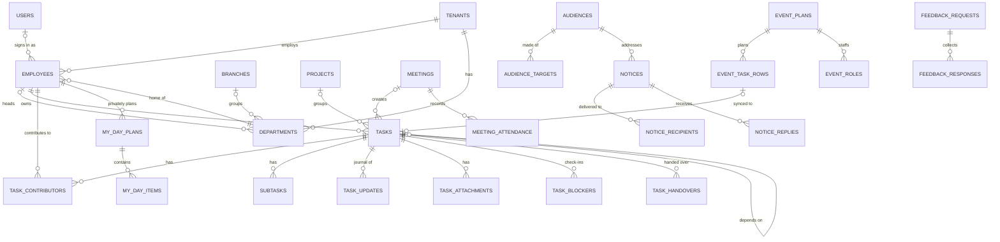

# Data model

Status: **draft for review**. This model assumes PostgreSQL 18 ([decision 1](README.md#5-decisions-needed)) and the tenancy design in [auth-and-tenancy.md](auth-and-tenancy.md). Table and column names are final candidates; types are indicative.

## 1. Conventions

| Rule             | Detail                                                                                                                                                                                                                             |
| ---------------- | ---------------------------------------------------------------------------------------------------------------------------------------------------------------------------------------------------------------------------------- |
| Primary keys     | `id uuid DEFAULT uuidv7()`. IDs are time-ordered (good for index locality), safe to show in URLs and unique across tenants, so a tenant can move to another database later.                                                        |
| Tenant column    | Every tenant-owned table has `tenant_id uuid NOT NULL`, `UNIQUE (tenant_id, id)` and the RLS policy from the auth doc §2.1. Child tables reference parents through `(tenant_id, parent_id)`.                                       |
| Standard columns | Unless noted otherwise, every table also has `created_at timestamptz`, `updated_at timestamptz` and `created_by uuid` (an employee). The tables below omit them.                                                                   |
| Time             | Instants are `timestamptz`, stored in UTC. Calendar days (due dates, attendance, meeting dates) are `date`, interpreted in `tenants.timezone` (default `Asia/Kolkata`). "Today" and "Overdue · 2 days" are computed, never stored. |
| Lifecycle        | Normal operations never delete rows. Lifecycle is recorded in columns: `archived_at`, `removed_at`, `access_status`.                                                                                                               |
| Enums            | Postgres enums for small, stable sets (status, priority). Tenant-configurable lists (departments, positions) are tables or free text.                                                                                              |
| Concurrency      | Records that several people edit (`tasks`, `meetings`, `event_plans`) carry `version int`. Mutations send `expectedVersion`; a mismatch returns `CONFLICT` and the client refetches.                                               |
| ORM              | Drizzle `pg-core`. RLS policies are declared beside each table with `pgPolicy`.                                                                                                                                                    |

## 2. Core relationships



The diagram omits attendance, leave, notifications, files and audit tables, which hang off `employees` and `tenants`.

## 3. Tables

### 3.1 Platform and identity (global: no `tenant_id`)

| Table                                                           | Columns                                                                                                                                                                                              | Notes                                                                                                                 |
| --------------------------------------------------------------- | ---------------------------------------------------------------------------------------------------------------------------------------------------------------------------------------------------- | --------------------------------------------------------------------------------------------------------------------- |
| `users`, `auth_accounts`, `auth_sessions`, `auth_verifications` | As defined by Better Auth, renamed through its `modelName` options. `users` gains `phone_number` and `phone_number_verified` from the phone plugin.                                                  | Owned by the auth library. We add `auth_sessions.active_tenant_id uuid NULL`.                                         |
| `tenants`                                                       | `slug` (unique), `name`, `timezone` default `'Asia/Kolkata'`, `locale` default `'en-IN'`, `status` (`trial`, `active`, `suspended`, `closed`), `plan`, `logo_file_id`, `settings jsonb`, `closed_at` | `settings` holds tenant switches, such as `requirePhotoForActivation`, `sessionMaxDays` and `autoApproveSameDaySick`. |
| `platform_admins`                                               | `user_id` (PK), `role` (`owner`, `support`)                                                                                                                                                          | Our own staff                                                                                                         |
| `support_access_grants`                                         | `tenant_id`, `platform_user_id`, `granted_by_employee_id`, `reason`, `starts_at`, `expires_at`, `revoked_at`                                                                                         | Read-only, time-boxed support access (auth doc §7)                                                                    |

### 3.2 Organization

| Table              | Columns                                                                                                                                                                                                                                                                                                                                                                                                                                                                                                           | Constraints and notes                                                                                                                                                                                                                                                                      |
| ------------------ | ----------------------------------------------------------------------------------------------------------------------------------------------------------------------------------------------------------------------------------------------------------------------------------------------------------------------------------------------------------------------------------------------------------------------------------------------------------------------------------------------------------------- | ------------------------------------------------------------------------------------------------------------------------------------------------------------------------------------------------------------------------------------------------------------------------------------------ |
| `branches`         | `name`, `city`, `archived_at`                                                                                                                                                                                                                                                                                                                                                                                                                                                                                     | `UNIQUE (tenant_id, lower(name))`. Hidden in the UI until a tenant has more than one ([decision 6](README.md#5-decisions-needed)).                                                                                                                                                         |
| `departments`      | `branch_id NULL`, `name`, `color` (design token: `saffron`, `mint`, `blue`, `coral`…), `head_employee_id NULL`, `archived_at`                                                                                                                                                                                                                                                                                                                                                                                     | `UNIQUE (tenant_id, lower(name))`. Departments and employees reference each other, so the head FK is nullable and `DEFERRABLE`. That lets a department and its head be created in one transaction. The seed's `people`, `done` and `open` numbers become computed values.                  |
| `employees`        | `user_id NULL`, `full_name`, `phone_e164 NULL`, `email citext NULL`, `photo_file_id NULL`, `position_title` (free text: "Meeting Secretary", "Faculty Coordinator"), `department_id`, `branch_id NULL`, `reporting_manager_id NULL`, `access_role` (`ceo`, `director`, `department_head`, `employee`), `access_status` (`invited`, `active`, `suspended`, `removed`), `joined_on date NULL`, `shift_start time`, `shift_end time`, `weekly_off smallint[]` (0 = Sunday), `status_changed_at`, `status_changed_by` | `UNIQUE (tenant_id, user_id)`, `UNIQUE (tenant_id, phone_e164)`, `UNIQUE (tenant_id, email)`. Duplicate checks move from name to phone and email; a matching name only triggers a warning. `CHECK (phone_e164 IS NOT NULL OR email IS NOT NULL)`, so every invitation has somewhere to go. |
| `role_permissions` | PK `(tenant_id, role, permission)`, `allowed bool`, `updated_by`, `updated_at`                                                                                                                                                                                                                                                                                                                                                                                                                                    | Rows for `director`, `department_head` and `employee`. The CEO is implicitly all-on and has no rows. `permission` is a code from the auth doc §4.2.                                                                                                                                        |
| `invitations`      | `employee_id`, `channel` (`phone`, `email`), `destination`, `token_hash`, `expires_at`, `accepted_at`, `revoked_at`, `invited_by`                                                                                                                                                                                                                                                                                                                                                                                 | At most one open invitation per employee (a partial unique index where `accepted_at IS NULL AND revoked_at IS NULL`)                                                                                                                                                                       |

### 3.3 People operations

| Table                | Columns                                                                                                                                                                                   | Constraints and notes                                                                                                                                                                                                                                           |
| -------------------- | ----------------------------------------------------------------------------------------------------------------------------------------------------------------------------------------- | --------------------------------------------------------------------------------------------------------------------------------------------------------------------------------------------------------------------------------------------------------------- |
| `attendance_records` | `employee_id`, `attendance_date date`, `status` (`present`, `late`, `absent`, `on_leave`), `note`, `marked_by`, `marked_at`                                                               | `UNIQUE (employee_id, attendance_date)`                                                                                                                                                                                                                         |
| `leave_requests`     | `employee_id`, `leave_type` (`leave`, `sick`), `start_date`, `end_date`, `reason`, `status` (`pending`, `approved`, `rejected`, `cancelled`), `decided_by`, `decided_at`, `decision_note` | `CHECK (end_date >= start_date)`. Availability is **derived**: an employee is "On leave" or "Sick" while an approved leave covers today, and "Back on 08 Oct" comes from `end_date`. The prototype's `status` and `statusNote` fields are therefore not stored. |

### 3.4 Work

| Table               | Columns                                                                                                                                                                                                                                                                                                                                                                                                                                                                                                                                                                                                                           | Constraints and notes                                                                                                                                                                                                                                                                                                                                                                                             |
| ------------------- | --------------------------------------------------------------------------------------------------------------------------------------------------------------------------------------------------------------------------------------------------------------------------------------------------------------------------------------------------------------------------------------------------------------------------------------------------------------------------------------------------------------------------------------------------------------------------------------------------------------------------------- | ----------------------------------------------------------------------------------------------------------------------------------------------------------------------------------------------------------------------------------------------------------------------------------------------------------------------------------------------------------------------------------------------------------------- |
| `projects`          | `name`, `label` ("Admissions + Academic"), `color`, `target_date NULL`, `due_note NULL` ("Quarterly"), `progress_estimate smallint NULL`, `archived_at`                                                                                                                                                                                                                                                                                                                                                                                                                                                                           | `UNIQUE (tenant_id, lower(name))`. `progress_estimate` is shown only while a project has no linked tasks, matching `projectProgress()` with `source: "estimate"`.                                                                                                                                                                                                                                                 |
| `tasks`             | `title`, `owner_employee_id`, `department_id`, `team_label NULL`, `family` (`squirrel`, `angad`, `sugriv`, `hanuman`), `source_type` (`manual`, `meeting`, `event`, `project`), `source_meeting_id NULL`, `event_task_row_id NULL`, `project_id NULL`, `status` (`todo`, `in_progress`, `blocked`, `done`), `priority` (`high`, `medium`, `low`), `visibility` (`department`, `private`, `leadership`), `progress smallint`, `due_date date NULL`, `is_team_task bool`, `long_running bool`, `depends_on_task_id NULL`, `owner_note NULL`, `completed_at`, `completed_by`, `reopened_at`, `archived_at`, `archived_by`, `version` | `CHECK (progress BETWEEN 0 AND 100)`; `CHECK ((status = 'done') = (completed_at IS NOT NULL))`; `CHECK (depends_on_task_id <> id)`; `CHECK (source_type <> 'meeting' OR source_meeting_id IS NOT NULL)`, with matching checks for `event` and `project`; `UNIQUE (event_task_row_id)`. A `NULL` `due_date` means "To be scheduled". Cycle prevention (`wouldCycle`) runs in the mutation, inside the transaction. |
| `task_contributors` | PK `(task_id, employee_id)`, `note NULL`, `completed_at NULL`, `completed_by NULL`                                                                                                                                                                                                                                                                                                                                                                                                                                                                                                                                                | The owner can never be a contributor; the mutation enforces this and a trigger backs it. A handover removes the recipient's row and moves their note to `owner_note`, as `handoverTaskPure` does.                                                                                                                                                                                                                 |
| `task_receipts`     | PK `(task_id, employee_id)`, `seen_at NULL`, `acknowledged_at NULL`                                                                                                                                                                                                                                                                                                                                                                                                                                                                                                                                                               | Replaces `seenBy` and `acknowledgedBy`                                                                                                                                                                                                                                                                                                                                                                            |
| `subtasks`          | `task_id`, `title`, `position int`, `done_at NULL`, `done_by NULL`                                                                                                                                                                                                                                                                                                                                                                                                                                                                                                                                                                |                                                                                                                                                                                                                                                                                                                                                                                                                   |
| `task_updates`      | `task_id`, `body`, `author_employee_id`                                                                                                                                                                                                                                                                                                                                                                                                                                                                                                                                                                                           | Append-only progress journal                                                                                                                                                                                                                                                                                                                                                                                      |
| `task_attachments`  | `task_id`, `kind` (`evidence`, `guidance`), `file_id NULL`, `url NULL`, `display_name`, `added_by`                                                                                                                                                                                                                                                                                                                                                                                                                                                                                                                                | `CHECK (num_nonnulls(file_id, url) = 1)`. URLs must be `http(s)`, validated by the existing `normaliseLink`. The prototype calls guidance `"material"`.                                                                                                                                                                                                                                                           |
| `task_blockers`     | `task_id`, `reason` (the 8 `BlockerReason` values), `note NULL`, `reported_by`, `reported_at`, `cleared_at NULL`, `cleared_by NULL`, `cleared_reason` (`moving_again`, `task_completed`)                                                                                                                                                                                                                                                                                                                                                                                                                                          | History, not just the current state. `UNIQUE (task_id) WHERE cleared_at IS NULL` allows one open check-in per task. Leadership blocker analytics query this table.                                                                                                                                                                                                                                                |
| `task_handovers`    | `task_id`, `from_employee_id`, `to_employee_id`, `status_snapshot`, `progress_snapshot`, `last_action`, `waiting_for`, `next_action`, `notes`                                                                                                                                                                                                                                                                                                                                                                                                                                                                                     | Full history, as the handover guide requires. The task card shows the latest row. `CHECK (from_employee_id <> to_employee_id)`                                                                                                                                                                                                                                                                                    |

**Hard delete.** Only the creator may hard-delete a task, within 15 minutes and before anyone else has touched it. Children cascade, and the `audit_events` row remains. In every other case the task is archived.

### 3.5 Meetings (MOM Directory)

| Table                | Columns                                                                                                                                                                           | Constraints and notes                                                                                                                                                                                                            |
| -------------------- | --------------------------------------------------------------------------------------------------------------------------------------------------------------------------------- | -------------------------------------------------------------------------------------------------------------------------------------------------------------------------------------------------------------------------------- |
| `meetings`           | `department_id`, `title`, `meeting_date date`, `head_employee_id`, `secretary_employee_id`, `minutes text`, `next_meeting_date NULL`, `locked_at timestamptz NOT NULL`, `version` | Saving a MOM locks it, so `locked_at` is set on insert. Quick-task rows become `tasks` with `source_type = 'meeting'` **in the same transaction**. The prototype's `actionItem` and `taskAssignee` are derived from those tasks. |
| `meeting_attendance` | PK `(meeting_id, employee_id)`, `present bool`                                                                                                                                    | The head and the secretary are always present (`createMomRecord` already forces this).                                                                                                                                           |

The written MOM is immutable, and the database enforces it:

```sql
CREATE FUNCTION forbid_locked_meeting_edits() RETURNS trigger AS $$
BEGIN
  IF OLD.locked_at IS NOT NULL AND
     (NEW.title, NEW.meeting_date, NEW.department_id, NEW.minutes, NEW.head_employee_id, NEW.secretary_employee_id)
       IS DISTINCT FROM
     (OLD.title, OLD.meeting_date, OLD.department_id, OLD.minutes, OLD.head_employee_id, OLD.secretary_employee_id) THEN
    RAISE EXCEPTION 'MOM % is locked', OLD.id USING ERRCODE = 'check_violation';
  END IF;
  RETURN NEW;
END $$ LANGUAGE plpgsql;

CREATE TRIGGER meetings_locked BEFORE UPDATE ON meetings
  FOR EACH ROW EXECUTE FUNCTION forbid_locked_meeting_edits();
```

A companion trigger rejects inserts, updates and deletes on `meeting_attendance` once the parent is locked. Authorized leaders can still add tasks later (`meetings.add_tasks_after_lock`), because those are rows in `tasks`, not edits to the meeting.

### 3.6 Event Planner

| Table                    | Columns                                                                                                                                            | Constraints and notes                                                                                                                                                                                                                                          |
| ------------------------ | -------------------------------------------------------------------------------------------------------------------------------------------------- | -------------------------------------------------------------------------------------------------------------------------------------------------------------------------------------------------------------------------------------------------------------- |
| `event_plans`            | `title`, `event_date NULL`, `venue`, `description`, `is_template bool`, `template_name NULL`, `copied_from_plan_id NULL`, `archived_at`, `version` | `CHECK (NOT is_template OR template_name IS NOT NULL)`. Templates never create tasks.                                                                                                                                                                          |
| `event_plan_departments` | PK `(event_plan_id, department_id)`                                                                                                                |                                                                                                                                                                                                                                                                |
| `event_roles`            | `event_plan_id`, `role_name`, `in_charge_employee_id`, `department_id`, `position`                                                                 |                                                                                                                                                                                                                                                                |
| `event_task_rows`        | `event_plan_id`, `title`, `department_id`, `assignee_employee_id`, `family`, `note`, `position`, `removed_at NULL`                                 | Rows are soft-removed so their synced task keeps its link. `syncEventTasks` moves to the server unchanged in meaning: a new row creates a task, an edited row updates its task and keeps the task's progress and history, and a removed row archives its task. |

### 3.7 Communication

Notices, feedback and calendar events all target people the same way, so they share one audience model. Targeting has a single implementation, and every link keeps a real foreign key.

| Table                | Columns                                                                                                                                                                                        | Constraints and notes                                                                                                                                                                         |
| -------------------- | ---------------------------------------------------------------------------------------------------------------------------------------------------------------------------------------------- | --------------------------------------------------------------------------------------------------------------------------------------------------------------------------------------------- |
| `audiences`          | _(only standard columns)_                                                                                                                                                                      | One per notice, feedback request or calendar event                                                                                                                                            |
| `audience_targets`   | `audience_id`, `target_type` (`everyone`, `role_group`, `department`, `employee`), `role_group NULL` (`directors`, `department_heads`, `candidates`), `department_id NULL`, `employee_id NULL` | A `CHECK` requires exactly the column that matches `target_type`. The prototype's `audience` label ("Targeted", "Department"…) is derived from the target rows.                               |
| `notices`            | `title`, `body`, `sender_employee_id`, `audience_id`, `requires_reply bool`, `sent_at`, `expires_at NULL`, `media_file_id NULL`, `withdrawn_at NULL`                                           | `expires_at = sent_at + period` (12 h, 24 h, 7 days or 1 month). A notice moves to the Notice Archive once `now() >= expires_at`. That state is **computed**, so the browser timer goes away. |
| `notice_recipients`  | PK `(notice_id, employee_id)`, `seen_at NULL`                                                                                                                                                  | The audience is **resolved and snapshotted at send time**. "Seen 7 of 9" stays stable when people later join or change departments.                                                           |
| `notice_replies`     | PK `(notice_id, employee_id)`, `body`, `replied_at`                                                                                                                                            | A separate table so that reading reply bodies is one guarded query: only the replier and the notice's sender can read a reply.                                                                |
| `feedback_requests`  | `title`, `prompt`, `kind` (`poll`, `open_question`, `rating`), `options text[] NULL`, `event_plan_id NULL`, `audience_id`, `closes_at NULL`                                                    | `CHECK ((kind = 'poll') = (options IS NOT NULL))`                                                                                                                                             |
| `feedback_responses` | PK `(request_id, employee_id)`, `answer_text NULL`, `option_index smallint NULL`, `rating smallint NULL`, `responded_at`                                                                       | One response per person. `CHECK (rating BETWEEN 1 AND 5)`. Responses are named, as in the prototype; anonymous feedback is an open question (§6).                                             |
| `calendar_events`    | `title`, `event_date date`, `type` (`holiday`, `festival`, `academic_program`, `birthday`, `other`), `audience_id`                                                                             | The prototype's `month` field is derived from `event_date`.                                                                                                                                   |

### 3.8 My Day (private)

| Table               | Columns                                                                                                                                                                                                                                                             | Constraints and notes                                                                                                                                                                                 |
| ------------------- | ------------------------------------------------------------------------------------------------------------------------------------------------------------------------------------------------------------------------------------------------------------------- | ----------------------------------------------------------------------------------------------------------------------------------------------------------------------------------------------------- |
| `my_day_plans`      | `employee_id`, `plan_date date`, `review_completed`, `review_pending`, `review_tomorrow_priority`                                                                                                                                                                   | `UNIQUE (employee_id, plan_date)`                                                                                                                                                                     |
| `my_day_items`      | `plan_id`, `employee_id`, `item_type` (`priority`, `schedule_block`, `actionable`), `title`, `notes`, `starts_at time`, `ends_at time`, `category`, `block_status` (`planned`, `in_progress`, `completed`, `missed`), `priority`, `due_date`, `done_at`, `position` | Each item type has its own `CHECK` on required columns. The mutation enforces "at most 3 priorities per day".                                                                                         |
| `my_day_task_links` | PK `(plan_id, task_id)`, `employee_id`                                                                                                                                                                                                                              | The linked task is read through normal task visibility. If the employee has since lost access, for example after a handover, the link shows "No longer available" and reveals nothing about the task. |

Items and links carry `employee_id`, kept consistent with the plan through a composite FK, so all three tables use the same extra policy. The policy is **`AS RESTRICTIVE`**, which means it is AND-ed with tenant isolation instead of OR-ed:

```sql
CREATE POLICY owner_only ON my_day_plans AS RESTRICTIVE
  USING (employee_id IN (
    SELECT id FROM employees
    WHERE user_id = NULLIF(current_setting('app.user_id', true), '')::uuid));
```

My Day rows never reach dashboards, search, exports, audit detail or support sessions.

### 3.9 System

| Table           | Columns                                                                                                                                                                                                                                                                                       | Constraints and notes                                                                                                                                                                                                                    |
| --------------- | --------------------------------------------------------------------------------------------------------------------------------------------------------------------------------------------------------------------------------------------------------------------------------------------- | ---------------------------------------------------------------------------------------------------------------------------------------------------------------------------------------------------------------------------------------- |
| `files`         | `storage_key` (unique, `tenants/<tenant_id>/<purpose>/<uuid>`), `original_name`, `content_type`, `size_bytes`, `sha256`, `purpose` (`task_attachment`, `notice_media`, `profile_photo`, `tenant_logo`, `export`), `scan_status` (`pending`, `clean`, `infected`), `uploaded_by`, `deleted_at` | Uploads go directly to storage through a presigned PUT. Downloads use short-lived signed GET URLs, issued only after a permission check on the record that owns the file. Each purpose has its own size limit and MIME allow-list.       |
| `notifications` | `recipient_employee_id`, `kind` (`assignment`, `reply`, `reminder`, `system`), `title`, `body`, `entity_type`, `entity_id`, `read_at NULL`                                                                                                                                                    | Kept for 90 days. A daily job creates deadline reminders, replacing the client-side `deadlineReminders` and `readReminderIds`.                                                                                                           |
| `audit_events`  | `occurred_at`, `actor_user_id NULL` (null for system jobs), `actor_employee_id NULL`, `on_behalf_of_user_id NULL` (support), `action` (code, e.g. `task.completed`), `entity_type`, `entity_id NULL`, `summary`, `detail jsonb`, `is_sensitive bool`, `ip inet NULL`, `user_agent NULL`       | Append-only: the app role is granted only `INSERT` and `SELECT`. No `updated_at` or `created_by`. Partitioned by month once large. Current display labels ("Task handed over", "MOM posted"…) map to codes, and the UI keeps the labels. |
| _(pg-boss)_     | its own `pgboss` schema                                                                                                                                                                                                                                                                       | Jobs are enqueued inside the mutation's transaction, so a rolled-back mutation never sends a notification.                                                                                                                               |

## 4. Prototype → schema mapping

| Prototype field                                                                     | Becomes                                                                                                                                          |
| ----------------------------------------------------------------------------------- | ------------------------------------------------------------------------------------------------------------------------------------------------ |
| `Task.assignee`, `initials`                                                         | `tasks.owner_employee_id` (initials are derived)                                                                                                 |
| `Task.department`, `team`                                                           | `department_id`, `team_label`                                                                                                                    |
| `Task.due` (`"Today"`, `"30 Sep"`, `"Overdue · 2 days"`, `"To be scheduled"`)       | `due_date`, or `NULL`; labels are computed in the tenant's time zone                                                                             |
| `Task.status: "progress"`                                                           | `in_progress`                                                                                                                                    |
| `Task.kind` + `source`                                                              | `source_type` + `source_meeting_id`, `event_task_row_id` or `project_id`. `kind: "HANUMAN"` becomes `family = 'hanuman'`, `long_running = true`. |
| `Task.category`, `project`                                                          | `family`, `project_id`                                                                                                                           |
| `assistants[]`, `assignmentNotes`                                                   | `task_contributors` (note, completion); `owner_note`                                                                                             |
| `seenBy`, `acknowledgedBy`                                                          | `task_receipts`                                                                                                                                  |
| `attachments`, `subtasks`, `updates`                                                | `task_attachments` + `files`, `subtasks`, `task_updates`                                                                                         |
| `blocker`, `handover`                                                               | `task_blockers`, `task_handovers` (full history; the UI shows the current one)                                                                   |
| `dependsOnTaskId`, `eventLink`                                                      | `depends_on_task_id`, `event_task_row_id`                                                                                                        |
| `archived`, `archivedBy`, `archivedAt`                                              | `archived_at`, `archived_by`                                                                                                                     |
| `EmployeeProfile.number`, `joiningYear`, `inTime`, `outTime`, `weeklyOff`           | `phone_e164`, `joined_on`, `shift_start`, `shift_end`, `weekly_off[]`                                                                            |
| `EmployeeProfile.status`, `statusNote`, `attendanceStatus`                          | Derived from `leave_requests` and today's `attendance_records`                                                                                   |
| `EmployeeProfile.access`                                                            | `access_status`                                                                                                                                  |
| MOM `attendance`, `absent`, `content`                                               | `meeting_attendance.present`, `minutes`                                                                                                          |
| `Notice.audience`, `recipients`, `seenBy`, `replies`, `period`, `binnedAt`, `media` | `audience_targets`, `notice_recipients`, `notice_replies`, `expires_at`, `media_file_id`                                                         |
| `accessMatrix`                                                                      | `role_permissions`                                                                                                                               |
| `AuditEntry`, `AppNotification`                                                     | `audit_events`, `notifications`                                                                                                                  |
| `PersonalPlan`                                                                      | `my_day_plans`, `my_day_items`, `my_day_task_links`                                                                                              |
| Department `done`/`open`/`people`, `instituteCompletion`, `rewardSummary`           | Computed, not stored                                                                                                                             |

The seed script converts `seed.ts` through this mapping into a **demo tenant**. It resolves names to employee IDs and relative due labels to dates around the seed clock (5 Oct 2026). The demo tenant gives developers realistic data and doubles as a migration test.

## 5. Key indexes

| Index                                                                                                                                   | Serves                                              |
| --------------------------------------------------------------------------------------------------------------------------------------- | --------------------------------------------------- |
| `tasks (tenant_id, owner_employee_id, status) WHERE archived_at IS NULL`                                                                | My Feed, Today's Mission                            |
| `tasks (tenant_id, department_id, due_date) WHERE archived_at IS NULL AND status <> 'done'`                                             | Department view, overdue counts, reminders          |
| `tasks (tenant_id, project_id)`, `tasks (tenant_id, source_meeting_id)`, `tasks (tenant_id, depends_on_task_id)`                        | Project progress, MOM follow-ups, downstream impact |
| `task_contributors (tenant_id, employee_id)`                                                                                            | "Team follow-ups" and contributor feeds             |
| `notice_recipients (tenant_id, employee_id) WHERE seen_at IS NULL`                                                                      | Unread notices                                      |
| `notifications (tenant_id, recipient_employee_id, created_at DESC) WHERE read_at IS NULL`                                               | Bell icon                                           |
| `audit_events (tenant_id, occurred_at DESC)`, `(tenant_id, entity_type, entity_id)`, `(tenant_id, occurred_at DESC) WHERE is_sensitive` | Audit Log filters                                   |
| `attendance_records (tenant_id, attendance_date)`                                                                                       | Daily attendance summary                            |

## 6. Open data questions

1. **"Candidates"**: is this a group of students, or of staff such as trainees or new joiners? The seed sends a "Candidates" notice to two faculty coordinators. Until this is answered, the role group resolves to no one.
2. **Birthdays**: should birthdays be derived from an optional `employees.date_of_birth`, or stay manual calendar entries as today?
3. **Anonymous feedback**: should a request be able to hide respondent names from its creator?
4. **Multiple upstream dependencies**: the UI supports one upstream task. If more are needed, `depends_on_task_id` becomes a `task_dependencies` join table.
5. **Notice recipients**: should people who join a department after a notice was sent also receive it? The snapshot design says no.
6. **Retention**: how long should we keep audit events and notifications for a closed tenant? Proposed: audit events for the tenant's lifetime plus 1 year, notifications for 90 days.
